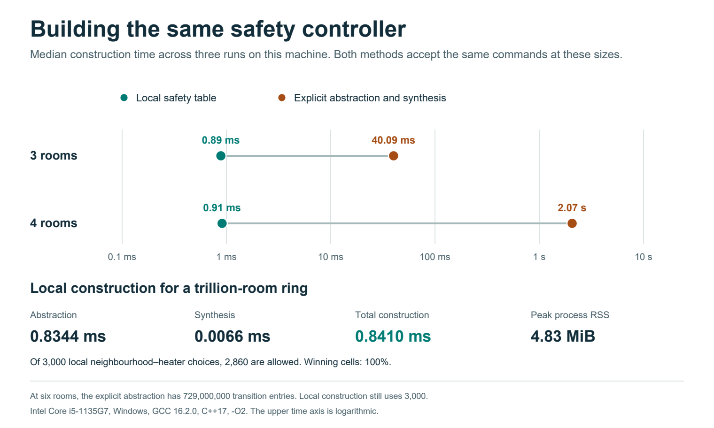
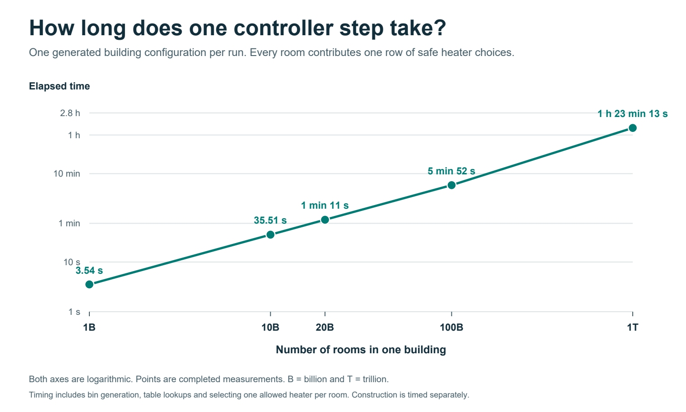

# Local abstraction and safety synthesis test results

Tested revision `529fe74` on Windows with an Intel Core i5-1135G7 and GCC 16.2.0 (C++17, -O2).

## Correctness

- **Dynamics** passed. Project dynamics and indexing assertions.
- **Abstraction** passed. Grid, command encoding, boundaries and sampled successor checks.
- **Simulation** passed. Seven simulation checks and three regenerated CSV trajectories.
- **Local equivalence** passed. All 27,000 three-room successor boxes and all 837,000 cell–command decisions at 3 and 4 rooms were checked. Includes the small simulation suites and the three regenerated traces.
- **Reference integration** passed. Explicit controller, policy-corruption checks, small simulations and the three archived traces.

## From bins to a controller

Think of A, B and C as consecutive rooms in a larger ring. To predict B's next temperature, the model uses their three current bins and B's own heater. A whole-building cell is the list of all room bins. The local controller reads those bins directly.

**Build the abstraction.** `local_transitions(0, 0, 0)` means that all three rooms currently lie in bin 0, from 17 to 17.5 °C. The function evaluates each heater at the coldest and warmest corners. Each prediction below describes B alone.

| Heater in B | Possible next temperature of B | Stored value (lowest bin, highest bin, can exit) |
|---|---|---|
| Off | 16.190–16.6675 °C | `{-1, -1, true}` |
| Medium | 17.081–17.545 °C | `{0, 1, false}` |
| High | 17.972–18.4225 °C | `{1, 2, false}` |

Here, −1 marks an empty intersection with the grid. `build_local_abstraction()` saves the three predictions for each of the 1,000 neighbourhoods, giving 3,000 local transitions.

**Build the controller.** `safe_heaters()` accepts a level if its successor bins exist and all its outcomes stay inside the grid. For the example it returns `{false, true, true}`: B may use medium or high. `synthesize_local_safety()` stores all 1,000 such rows and checks that each has an allowed level. Every building cell therefore has an input that keeps every room safe, and the first safety pass is a fixed point. The output contains the full-grid winning certificate and the table of every allowed heater choice.

**Apply the controller.** For a four-room cell `(2, 5, 7, 1)`, read `allowed[2][5][7]` for B and `allowed[5][7][1]` for C. Each room gets one lookup. Global cell IDs are used by the explicit reference tests. A large application streams the input bins and delivers the outputs in batches, all for the same time step.

## Controller construction

Each local build computes 3,000 local transitions, certifies the winning domain and constructs the complete table of heater choices. Times below are medians of three fresh build-only processes. The RSS column is the median of process high-water marks sampled just after synthesis.

| Rooms | Abstraction (ms) | Synthesis (ms) | Total (ms) | Peak RSS (MiB) | Winning cells |
|---:|---:|---:|---:|---:|---:|
| 3 | 0.8790 | 0.0067 | 0.8852 | 4.84 | 100% |
| 4 | 0.9031 | 0.0066 | 0.9092 | 4.83 | 100% |
| 1,000,000,000 | 0.8379 | 0.0063 | 0.8444 | 4.83 | 100% |
| 10,000,000,000 | 0.8443 | 0.0066 | 0.8506 | 4.83 | 100% |
| 20,000,000,000 | 0.8614 | 0.0066 | 0.8682 | 4.83 | 100% |
| 100,000,000,000 | 0.8430 | 0.0067 | 0.8497 | 4.84 | 100% |
| 1,000,000,000,000 | 0.8344 | 0.0066 | 0.8410 | 4.83 | 100% |

The [individual trials](build_trials.csv) also include the explicit reference builds at three and four rooms. The explicit executable samples peak RSS after construction and before verifying the controller.

**Why all cells are winning.** In the three-room test, all 1,000 cells had at least one command keeping every successor inside the safe grid. The explicit and local algorithms agreed on exactly 23,582 safe cell–command pairs out of 27,000. Medium heat in every room provides one safe choice from every cell. The maximal controller also retains every other safe choice.

### Independent controller comparison

The explicit and local controllers for three rooms agreed on 23,582 safe cell–command pairs. For four rooms they agreed on 687,400. These counts cover every grid cell and every global command at the two sizes. [Verifier output](correctness.txt)

| Rooms | Explicit build, median of three | Local build, median of three |
|---:|---:|---:|
| 3 | 40.091 ms | 0.8852 ms |
| 4 | 2,067.000 ms | 0.9092 ms |

## One-step application

Each size uses one configuration generated from the same reproducible sequence of room bins. Each run streams all rooms, selects the first allowed level for each room and discards each used block. Each completed run was checked to have produced exactly one row per room. The large two-step verifier was excluded for every size.

| Rooms | Rows produced | One step | Million rooms/s |
|---:|---:|---:|---:|
| 1,000,000,000 | 1,000,000,000 | 3.54 s | 282.37 |
| 10,000,000,000 | 10,000,000,000 | 35.51 s | 281.58 |
| 20,000,000,000 | 20,000,000,000 | 1 min 11 s | 282.22 |
| 100,000,000,000 | 100,000,000,000 | 5 min 52 s | 283.97 |
| 1,000,000,000,000 | 1,000,000,000,000 | 1 h 23 min 13 s | 200.30 |

The [raw one-step measurements](one_step.csv) include the construction timing from each application process. The reported peak RSS covers construction. It was sampled before the application began. The large sizes run sequentially after the other tests.

[Download both figures as a vector PDF](figures.pdf).
