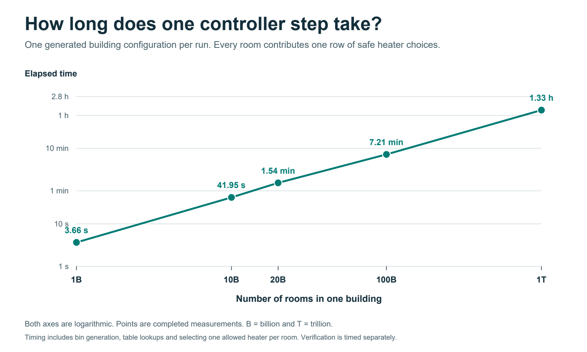
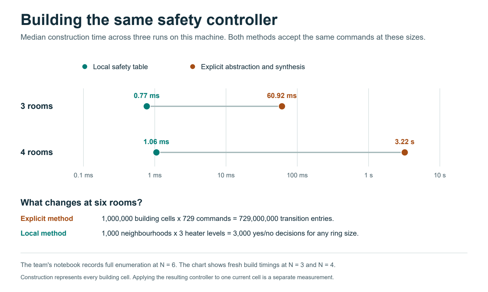

# Temperature controller scalability measurements

Each large timing run generates one current building cell, with one bin per room. The controller emits one row of three safe-heater flags per room in blocks of up to 65,536. The timing consumer picks the first allowed level and totals its index. Raw per-room inputs and outputs are discarded after use.

## Measured results

| Rooms | Timed rows | One step | Million rooms/s | Two-step replay |
|---:|---:|---:|---:|:---|
| 1,000,000,000 | 1,000,000,000 | 3.66 s | 273.4 | PASS |
| 10,000,000,000 | 10,000,000,000 | 41.95 s | 238.4 | PASS |
| 20,000,000,000 | 20,000,000,000 | 1.54 min | 216.4 | PASS |
| 100,000,000,000 | 100,000,000,000 | 7.21 min | 231.3 | PASS |
| 1,000,000,000,000 | 1,000,000,000,000 | 1.33 h | 209.3 | Skipped to save time (pass expected) |

The trillion-room timing covers one complete controller step. We expect the two-step replay to pass because every building size uses the same 3,000 verified local heater decisions, and both steps matched the reference at every tested size through 100 billion rooms.

Each replay checks all three heater choices for each room against an independently computed reference, chooses the first allowed level, and checks the resulting temperature against the model and the 17–22 °C interval. Its second step uses the updated bins. A pass covers this two-step trajectory. The checksums in the timing and replay runs use different deterministic inputs.

For example, the controller returned the following rows for one three-room cell. Each row is available to the caller until its batch is reused.

| Room | Current bin | Off | Medium | High |
|---|---:|---|---|---|
| A | 0 | Yes | Yes | Yes |
| B | 0 | Yes | Yes | Yes |
| C | 9 | No | Yes | Yes |

## Comparison with the explicit controller

| Rooms | Explicit build | Local table build | Cell–command decisions compared |
|---:|---:|---:|---:|
| 3 | 60.92 ms | 0.773 ms | 27,000 agree |
| 4 | 3,217.50 ms | 1.055 ms | 810,000 agree |

The team notebook records six rooms as the largest previous fully enumerated run. At six rooms the explicit method has 729,000,000 transition entries. The six-room count is exact and its run is historical. The fresh build timings above use the same computer and compiler for both methods. Each is the median of three trials. The explicit timer includes model construction and synthesis. The local timer includes building and certifying the complete table.

## Correctness checks

- All six existing integration suites passed. The optimized and explicit policies matched for every cell and command in the three- and four-room grids.
- The small simulation suite passed 18 named checks at three rooms and three at four rooms, plus fixed-seed sweeps of 200 and 50 cases. The cold, hot and mixed 50-step traces from Amine's simulator passed Rayane's independent checks.
- The 65,538-room boundary test passed both steps, including the last-to-first ring connection. Its maximum measured temperature error against the reference was zero on both steps.
- Before each ring replay the checker recomputes and compares all 3,000 local decisions once.

## Measurement conditions

Windows, Intel Core i5-1135G7, GCC 16.2.0, C++17, -O2. Each controller timing uses one thread and one run per large size. The timing series and the independent verification series run concurrently on the same machine, so wall times reflect shared CPU load. Table construction, policy application and the two-step replay are timed separately. Per-room file I/O is excluded.

The benchmark uses seed 42. The replay starts at bin centres on a separately generated reproducible ring. See the [one-step benchmark](../../IntegrationTests/benchmark_policy_application.cpp), [correctness verifier](../correctness_verification.cpp) and [large-ring replay](../../IntegrationTests/large_ring_replay.hpp).

Download the [vector figures](figures.pdf), [per-size timings and replay records](measurements.csv), or [individual build trials](controller_builds.csv).
